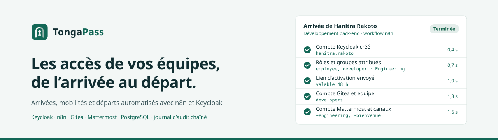
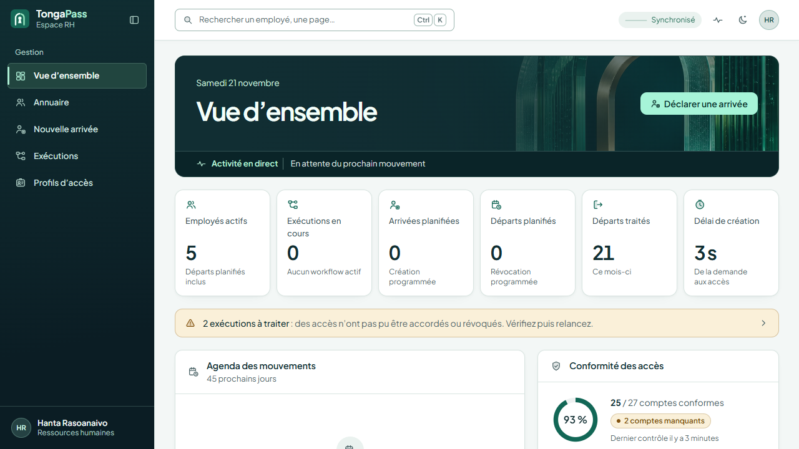
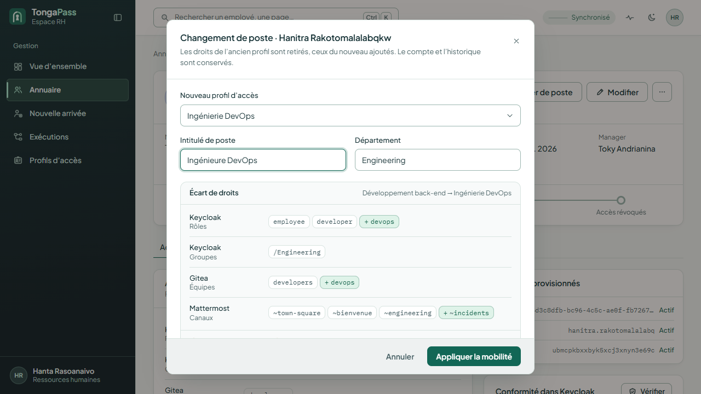
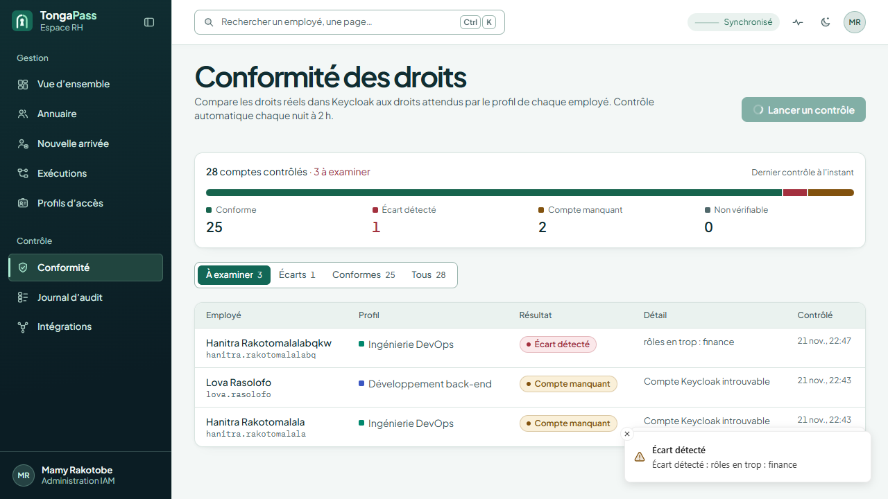
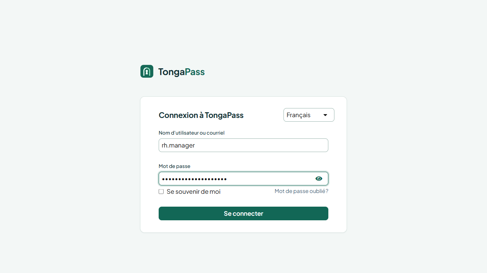
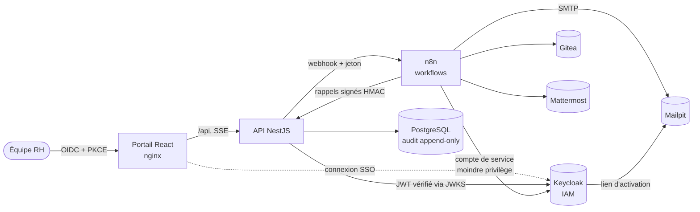

<p align="center">
  
</p>

<p align="center">
  <a href="#démarrage-rapide"></a>
  
  
  
  
  
</p>

# TongaPass

**Intégration et départ automatisés des employés avec n8n et Keycloak.** Projet **P03** du catalogue de veille technologique ESTI, Licence 3, domaine *Automatisation + IAM*.

*Tonga* signifie « arriver » en malgache (*tonga soa* veut dire « bienvenue »). TongaPass gère tout le cycle de vie des accès d'un employé (le modèle *Joiner-Mover-Leaver* des outils IAM) : il crée les comptes au bon moment, ajuste les droits à chaque changement de poste, les révoque le jour du départ, puis **vérifie chaque nuit** que les droits réels dans Keycloak correspondent toujours aux droits attendus. Chaque geste laisse une trace d'audit infalsifiable.

| Arrivée (immédiate ou planifiée) | Mobilité interne | Départ (immédiat, planifié ou en fin de contrat) |
|---|---|---|
| Compte Keycloak avec les rôles et groupes du profil | Aperçu de l'écart de droits avant validation | Compte Keycloak désactivé |
| Lien d'activation par e-mail (aucun mot de passe envoyé) | Rôles et groupes de l'ancien profil retirés, nouveaux ajoutés | Sessions, jetons hors ligne et consentements révoqués |
| Compte Gitea et équipes du profil | Équipes Gitea ajustées | Rôles et groupes retirés |
| Compte Mattermost, canaux, annonce dans `~bienvenue` | Canaux Mattermost rejoints | Gitea bloqué, Mattermost désactivé |
| E-mail de bienvenue sur l'adresse personnelle | Récapitulatif au manager | Récapitulatif au manager et aux RH |
| Comptes créés la veille de l'arrivée par défaut | Date d'effet planifiable | Révocation programmée automatiquement à la fin d'un CDD ou d'un stage |

<p align="center">
  
  
</p>
<p align="center">
  
  
</p>

## Sommaire

- [Fonctionnalités](#fonctionnalités)
- [Architecture](#architecture)
- [Démarrage rapide](#démarrage-rapide)
- [Démonstration en 5 minutes](#démonstration-en-5-minutes)
- [Structure du dépôt](#structure-du-dépôt)
- [API et contrat d'automatisation](#api-et-contrat-dautomatisation)
- [Sécurité (DevSecOps)](#sécurité-devsecops)
- [Tests et qualité](#tests-et-qualité)
- [Livrables du projet](#livrables-du-projet)

## Fonctionnalités

**Portail RH** en React 19. L’interface utilise les couleurs bleu nuit et lagon en clair et en sombre. [Charte graphique](docs/branding/charte-graphique.md)

- **Vue d'ensemble** : indicateurs clés, agenda des arrivées, mobilités et départs des 45 prochains jours, exécutions à traiter, fins de contrat sans départ planifié, état de conformité, graphique mensuel accessible (vue tableau).
- **Assistant d'arrivée en 3 étapes** : identité, poste et profil d'accès, vérification. L'identifiant et l'e-mail professionnel sont générés automatiquement. Les comptes sont créés **la veille de l'arrivée** par défaut (ou tout de suite, ou à une date choisie) ; pour un CDD ou un stage, la révocation est programmée à la fin du contrat. Les droits sensibles sont signalés et les droits supplémentaires doivent être justifiés.
- **Mobilité interne** : changement de profil, de poste ou de service avec **aperçu de l'écart de droits** (ajoutés, retirés, conservés) avant validation, application immédiate ou planifiée.
- **Suivi en temps réel** : chaque étape exécutée par n8n se valide dans la frise (Server-Sent Events), sans rechargement. Toute exécution planifiée peut être avancée ou annulée.
- **Départ sécurisé** : révocation immédiate ou planifiée, confirmation obligatoire par recopie de l'identifiant, annulation possible avant l'échéance.
- **Fiche employé** : frise du cycle de vie, accès effectifs par système, comptes provisionnés, vérification de conformité en un clic, exécutions et historique d'audit de la personne.
- **Annuaire** : recherche, filtres et tri conservés dans l'URL, export CSV, actions rapides par ligne.
- **Conformité** : les droits réels dans Keycloak (lus par un compte de service en **lecture seule**) sont comparés aux droits attendus ; un rôle ajouté à la main dans la console est signalé comme écart. Contrôle automatique chaque nuit à 2 h.
- **Profils d'accès** : modèles de droits par poste, composés à partir d'un catalogue fermé (impossible d'y glisser un rôle d'administration).
- **Journal d'audit** : filtres par action, acteur et période, vérification d'intégrité de la chaîne de hachage en un clic, export CSV.
- **Intégrations** : état et latence de Keycloak, n8n, Gitea, Mattermost et SMTP.
- **Activité en direct**. La barre supérieure signale chaque événement reçu. Le tableau de bord affiche le dernier mouvement et le fil d’activité conserve les 30 derniers événements.
- **Navigation**. La barre latérale se replie sur ordinateur et s’ouvre en tiroir sur téléphone. À l’accueil, une démonstration animée permet de comparer arrivée, mobilité et départ.
- **Palette de commandes** (Ctrl/⌘ + K), thème clair et sombre, `prefers-reduced-motion` respecté, WCAG 2.2 AA vérifié par axe-core.

**API** (NestJS 12, PostgreSQL 17) : 36 routes documentées en OpenAPI, autorisation par rôles Keycloak, rappels n8n signés en HMAC, idempotence, planificateur (arrivées, mobilités et départs planifiés, relance des exécutions non transmises, chien de garde des exécutions bloquées), contrôle de conformité nocturne, erreurs au format RFC 9457. Les dates (« aujourd'hui », « ce mois-ci ») sont calculées dans le fuseau de l'entreprise (`COMPANY_TIMEZONE`, par défaut `Indian/Antananarivo`).

**Automatisation** (n8n 2.48) : 4 workflows versionnés « as code » (arrivée, mobilité, départ, rappel signé), importés et publiés au démarrage, idempotents (relance sans doublon).

## Architecture



L'API est la **source de vérité** : employés, exécutions, étapes et journal d'audit. **n8n exécute** les actions sur les outils et rend compte de chaque étape. Détails, séquences et modèle de données : [docs/architecture.md](docs/architecture.md).

## Démarrage rapide

**Prérequis** : Docker Desktop (ou Docker Engine et Compose v2), Node.js ≥ 22.12, environ 6 Go de RAM libre.

```bash
git clone <url-du-depot> tongapass && cd tongapass
node scripts/init-env.mjs        # génère .env avec des secrets aléatoires (affiche le mot de passe de démo)
docker compose up -d --build     # 9 services ; premier démarrage ≈ 3 min
```

| Service | URL | Identifiants |
|---|---|---|
| **Portail TongaPass** | http://localhost:8088 | `rh.manager`, `admin.it` ou `auditeur` + mot de passe affiché par `init-env` |
| Documentation de l'API (Swagger) | http://localhost:4100/api/docs | jeton Bearer du portail |
| Keycloak (console) | http://localhost:8180/admin | `admin` / `KEYCLOAK_ADMIN_PASSWORD` du `.env` |
| n8n (workflows) | http://localhost:5678 | `N8N_OWNER_EMAIL` / `N8N_OWNER_PASSWORD` du `.env` |
| Mailpit (e-mails envoyés) | http://localhost:8025 | — |
| Gitea | http://localhost:3300 | `tp-provisioner` / `GITEA_ADMIN_PASSWORD` |
| Mattermost | http://localhost:8065 | `tp-provisioner` / `MATTERMOST_ADMIN_PASSWORD` |

Pour une version allégée sans Mattermost, mettez `COMPOSE_PROFILES=` et `CHAT_ENABLED=false` dans `.env`.

Tous les ports sont liés à `127.0.0.1`. Développement sans Docker (doublures OIDC et n8n) : voir [tools/dev-stubs/README.md](tools/dev-stubs/README.md).

## Démonstration en 5 minutes

1. Connectez-vous en **rh.manager** : la vue d'ensemble présente l'agenda des mouvements et l'état de conformité.
2. **Déclarer une arrivée** : Hanitra Rakoto, profil *Développement back-end*, création des comptes **maintenant**.
3. Regardez les 6 étapes se valider. Ouvrez **Mailpit** : l'e-mail de bienvenue et le lien d'activation Keycloak sont arrivés.
4. Contrôlez le résultat dans **Keycloak** (utilisateur, rôles, groupe), **Gitea** (équipe `developers`) et **Mattermost** (annonce dans `~bienvenue`).
5. Sur la fiche, **Changer de poste** vers *Ingénierie DevOps* : l'aperçu montre les droits ajoutés (`devops`, équipe `devops`, canal `~incidents`). Appliquez.
6. Dans la console Keycloak, ajoutez à la main le rôle `finance` à l'utilisateur. Sur la fiche, **Vérifier** : l'écart est détecté.
7. **Plus d'actions → Déclarer le départ**, recopiez l'identifiant et révoquez : tout est désactivé en quelques secondes.
8. Connectez-vous en **auditeur** : **Conformité → Lancer un contrôle**, puis **Journal d'audit → Vérifier l'intégrité**.

Le script complet de la vidéo (3 à 5 min) est dans [docs/guide-demo.md](docs/guide-demo.md).

## Structure du dépôt

```
tongapass/
├── apps/
│   ├── api/                 # NestJS 12 : auth, employees, onboarding, mobility, offboarding, compliance, workflows, audit…
│   └── portal/              # React 19 + Vite 8 + Tailwind 4 : portail RH
├── automation/n8n/          # workflows « as code » : code/*.js → workflows/*.json (build-workflows.mjs)
├── infra/
│   ├── keycloak/            # royaume tongapass (import) + thème de connexion
│   ├── postgres/init/       # une base et un utilisateur par service
│   ├── gitea/  bootstrap/   # démarrage et initialisation idempotente des outils
├── e2e/                     # Playwright : parcours (doublures) + recette sur la pile réelle
├── tools/dev-stubs/         # doublures OIDC et n8n pour le développement et la CI
├── docs/                    # architecture, sécurité, veille, article, branding, démo, communauté
├── .github/workflows/ci.yml # CI/CD DevSecOps
└── docker-compose.yml
```

## API et contrat d'automatisation

- **OpenAPI** : http://localhost:4100/api/docs (JSON : `/api/docs-json`). Authentification par jeton Bearer Keycloak (audience `tongapass-api`).
- **Rôles** : `tp-hr` (arrivées, mobilités et départs), `tp-auditor` (lecture seule, audit et conformité), `tp-admin` (profils d'accès, tout le reste).
- **Contrat n8n**, c'est-à-dire la charge utile des webhooks, les clés d'étapes et la signature des rappels : [automation/n8n/README.md](automation/n8n/README.md).

## Sécurité (DevSecOps)

- **Moindre privilège à tous les niveaux** :
  - n8n utilise un compte de service Keycloak limité à la gestion des utilisateurs. Il ne peut pas administrer le royaume, ce qui a été vérifié.
  - Le contrôle de conformité utilise un second compte de service, `tongapass-auditor`, en **lecture seule** (`view-users`, `query-users`, `query-groups`) : l'outil qui vérifie ne peut rien modifier.
  - Le portail ne reçoit que les rôles `tp-*` (`fullScopeAllowed: false`).
  - Chaque service a sa propre base PostgreSQL.
- **Aucun secret dans le dépôt** : `.env` généré localement, placeholders `${…}` dans le royaume Keycloak, identifiants n8n chiffrés à l'import, Gitleaks en CI.
- **Rappels n8n signés** HMAC-SHA256 avec horodatage (anti-rejeu, fenêtre de 5 min) et comparaison à temps constant.
- **Journal d'audit** chaîné par SHA-256 et protégé par un déclencheur PostgreSQL qui interdit `UPDATE`, `DELETE` et `TRUNCATE`.
- **Durcissement** :
  - Helmet et CSP stricte côté portail, limitation de débit, validation stricte des entrées (`whitelist`, `forbidNonWhitelisted`).
  - Conteneurs `no-new-privileges`, API en lecture seule et non root, nginx non privilégié.

Analyse de menaces et correspondance OWASP : [docs/securite.md](docs/securite.md).

## Tests et qualité

| Commande | Ce qui est vérifié |
|---|---|
| `cd apps/api && npm test` | 43 tests unitaires : génération d'identifiants, HMAC, chaîne de hachage, gardes de rôles, calcul d'écart de droits, conformité |
| `cd apps/api && npm run test:e2e` | 41 tests sur un vrai PostgreSQL : sécurité JWT, rôles, arrivée planifiée et annulée, mobilité, départ automatique en fin de CDD, conformité, relance, idempotence, audit append-only |
| `cd apps/portal && npm test` | Composants et utilitaires (Vitest + Testing Library) |
| `cd e2e && npm test` | Parcours navigateur Playwright et audit d'accessibilité **axe-core** (clair et sombre) |
| `cd e2e && npm run test:stack` | **Recette sur la pile Docker réelle** : vérifie dans Keycloak, Gitea, Mattermost et Mailpit que les accès sont créés, ajustés à la mobilité puis révoqués, et qu'un rôle ajouté hors TongaPass est détecté |
| `node automation/n8n/build-workflows.mjs` | Génère les workflows et vérifie la syntaxe JS et les connexions |

La CI ([.github/workflows/ci.yml](.github/workflows/ci.yml)) enchaîne lint, typage, tests unitaires et e2e, build, Playwright, **Gitleaks**, **Trivy** (dépendances, Dockerfiles, images) et `npm audit`.

Les captures de [docs/screenshots/](docs/screenshots/) sont produites par la recette `test:stack` sur la pile réelle (thèmes clair et sombre). Le bilan des vérifications est dans [docs/rapport-verification.md](docs/rapport-verification.md).

## Livrables du projet

| Axe (grille ESTI) | Livrable | Emplacement |
|---|---|---|
| Veille technologique (3 pts) | Fiche de veille : état de l'art, comparaison n8n, Make, Zapier, Node-RED et Keycloak, Authentik, Zitadel | [docs/veille-technologique.md](docs/veille-technologique.md) |
| Technique (7 pts) | Dépôt, démonstration fonctionnelle, Docker Compose, tests, OpenAPI | ce dépôt |
| DevOps / DevSecOps (3 pts) | CI/CD, conteneurs durcis, scans, IAM | [.github/workflows/ci.yml](.github/workflows/ci.yml), [docs/securite.md](docs/securite.md) |
| Publication (3 pts) | Article de blog, script de la vidéo de démonstration | [docs/article-blog.md](docs/article-blog.md), [docs/guide-demo.md](docs/guide-demo.md) |
| Branding (2 pts) | Nom, logo, charte graphique, bannière, présentation de l'équipe | [docs/branding/](docs/branding/charte-graphique.md), [docs/equipe.md](docs/equipe.md) |
| Communauté (2 pts) | Contributions prêtes à publier (n8n, Keycloak, Stack Overflow) et atelier | [docs/communaute.md](docs/communaute.md) |

## Licence

[MIT](LICENSE). Les comptes et noms de la démonstration sont fictifs.
