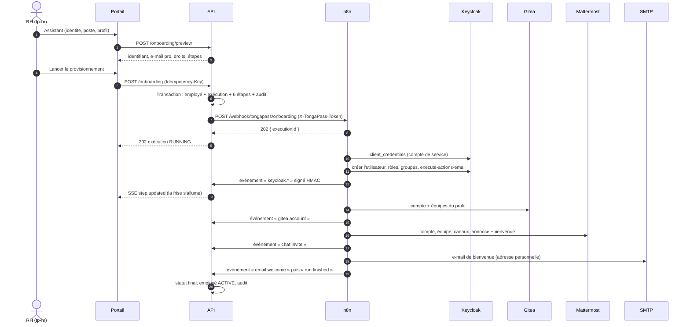
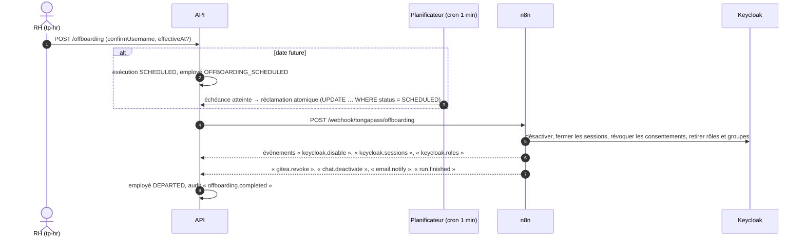
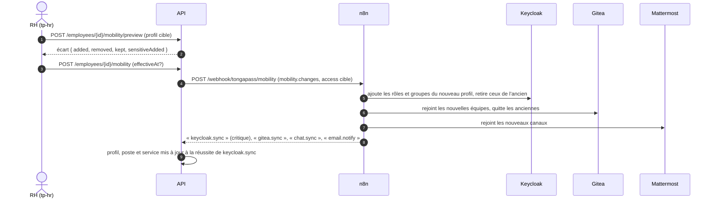
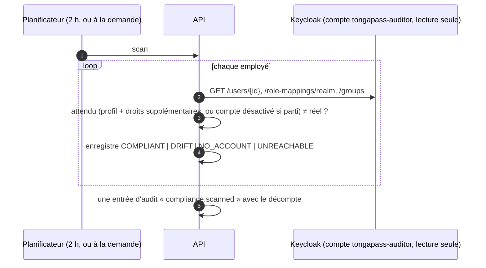
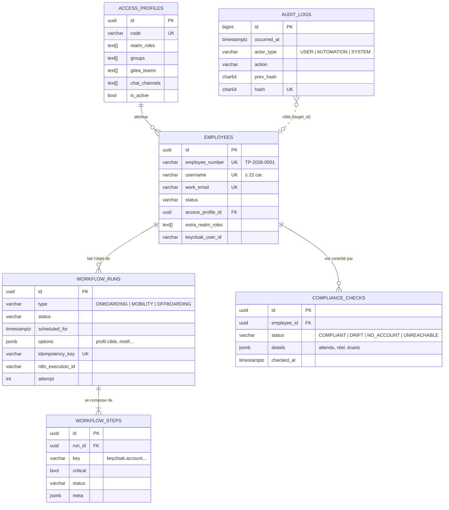

# Architecture de TongaPass

## 1. Vue d'ensemble

| Composant | Technologie | Responsabilité |
|---|---|---|
| Portail RH | React 19, Vite 8, Tailwind 4, TanStack Query, keycloak-js | Interface RH, audit et administration ; SSO OIDC + PKCE |
| API | NestJS 12, TypeORM 1, PostgreSQL 17 | Source de vérité : employés, profils, exécutions, étapes, audit ; déclenchement de n8n ; SSE |
| Automatisation | n8n 2.48 | Exécution des actions sur Keycloak, Gitea, Mattermost et SMTP ; rappels signés |
| IAM | Keycloak 26.8 | Identités, rôles, groupes, sessions ; e-mails d'activation |
| Outils provisionnés | Gitea, Mattermost | Forge Git et messagerie d'équipe |
| SMTP | Mailpit | Capture des e-mails (démonstration) |
| Bootstrap | Node 24 (script) | Initialisation idempotente : profil utilisateur Keycloak, organisation et équipes Gitea, équipe et canaux Mattermost |

Réseaux Docker : `backend` (tous les services) et `frontend` (portail ↔ API). Tous les ports publiés sont liés à `127.0.0.1`.

## 2. Arrivée (onboarding)



**Règles de statut :**
- Une étape **critique** en échec (`keycloak.account`) donne une exécution `FAILED`.
- Une étape secondaire en échec donne `PARTIAL` (accès à vérifier, relance possible).
- Si aucune nouvelle n'arrive au-delà de `AUTOMATION_TIMEOUT_MINUTES`, l'exécution passe en `TIMED_OUT` (chien de garde).

## 3. Départ (offboarding)



La révocation **continue même si une étape échoue**, pour ne laisser aucun accès résiduel. Le récapitulatif envoyé au manager signale explicitement les étapes à relancer.

Pour un **CDD ou un stage**, l'assistant d'arrivée peut programmer ce départ dès la déclaration (`options.scheduleDepartureAtEnd`) : une exécution `OFFBOARDING` planifiée est créée pour le dernier jour du contrat à 18 h (heure de l'entreprise) au moment où l'arrivée se termine. Elle reste visible, annulable et avançable comme toute planification.

## 3 bis. Mobilité interne (mover)



Le calcul d'écart (`access-diff.ts`) ne retire jamais le rôle de base `employee` ni le canal `town-square`. Le profil de l'employé n'est modifié **qu'après** la confirmation de Keycloak : si l'étape critique échoue, la fiche conserve l'ancien profil et l'exécution peut être relancée.

## 3 ter. Planification

Toute exécution peut être différée : arrivée (`provisionAt`, par défaut la veille de l'arrivée à 8 h), mobilité (`effectiveAt`), départ (`effectiveAt`). Le planificateur (cron chaque minute) :

1. déclenche les exécutions `SCHEDULED` arrivées à échéance (réclamation atomique `UPDATE … WHERE status = 'SCHEDULED'`) ;
2. renvoie à n8n les exécutions restées `QUEUED` sans identifiant d'exécution depuis plus de 90 s (n8n indisponible au moment du déclenchement) ;
3. passe en `TIMED_OUT` les exécutions sans signal depuis `AUTOMATION_TIMEOUT_MINUTES`.

`POST /workflow-runs/{id}/run-now` avance une planification, `POST /workflow-runs/{id}/cancel` l'annule (l'employé revient à l'état précédent ; une arrivée annulée passe en `CANCELLED`).

## 3 quater. Contrôle de conformité



Le contrôle utilise un **second compte de service** dont les seuls droits sont `view-users`, `query-users` et `query-groups` : l'outil qui vérifie ne peut rien corriger, et un compte compromis ne permettrait pas de modifier les accès. Le rôle composite technique `default-roles-tongapass` est ignoré dans la comparaison. Une vérification lancée depuis la fiche d'un employé ajoute en plus une entrée d'audit sur cette personne (`compliance.checked` ou `compliance.drift`).

## 4. Modèle de données



Les migrations sont versionnées (`apps/api/src/database/migrations`) et appliquées au démarrage du conteneur. `synchronize` n'est jamais activé. Les sessions PostgreSQL de l'API utilisent le fuseau de l'entreprise (`COMPANY_TIMEZONE`) : « aujourd'hui » et « ce mois-ci » ont le même sens pour la base et pour les RH.

## 5. Organisation du code de l'API

```
src/
├── common/        décorateurs (@Public, @Roles, @Actor), gardes (JWT, rôles, HMAC), filtre RFC 9457, utilitaires
├── config/        configuration typée + validation Joi (refus de démarrer si incomplète)
├── database/      options TypeORM, migrations, exécuteur de migrations
└── modules/
    ├── auth/              vérification des jetons Keycloak (JWKS), /me
    ├── access-profiles/   catalogue fermé et profils
    ├── employees/         annuaire, fiche, génération d'identité
    ├── onboarding/        aperçu et déclaration d'arrivée
    ├── mobility/          aperçu d'écart de droits et changement de poste
    ├── offboarding/       départ immédiat ou planifié, annulation
    ├── compliance/        lecture seule de Keycloak, comparaison attendu / réel, contrôle nocturne
    ├── workflows/         exécutions, étapes, client n8n, callbacks, planificateur, avancer / annuler
    ├── audit/             chaîne de hachage, vérification, export CSV
    ├── events/            bus SSE
    ├── dashboard/         indicateurs, agenda des mouvements, fins de contrat, conformité
    └── health/            sondes (Terminus) et intégrations
```

## 6. Décisions d'architecture (ADR courts)

| # | Décision | Alternatives écartées | Justification |
|---|---|---|---|
| 1 | L'API est la source de vérité, n8n exécute | Tout dans n8n | Audit, idempotence, relance et chien de garde impossibles à garantir dans n8n seul |
| 2 | Rappels n8n signés HMAC + horodatage | Jeton partagé simple | Intégrité du corps et protection contre le rejeu |
| 3 | Workflows « as code » (`code/*.js` → JSON généré) | Édition dans l'UI seulement | Revue de code, diff lisible, CI qui vérifie la syntaxe |
| 4 | Lien d'activation Keycloak, aucun mot de passe envoyé | Mot de passe temporaire par e-mail | Un secret ne doit jamais transiter en clair |
| 5 | Catalogue fermé des droits attribuables | Saisie libre des rôles | Empêche l'escalade de privilèges par un profil |
| 6 | SSE via fetch (en-tête Authorization) | WebSocket, jeton en URL | Le jeton n'apparaît jamais dans une URL ni dans les journaux |
| 7 | Doublures OIDC et n8n pour la CI | Pile complète en CI | Parcours navigateur en quelques minutes, recette réelle séparée (`test:stack`) |
| 8 | Mobilité = un workflow dédié qui applique un écart | Départ puis nouvelle arrivée | Conserve le compte, l'historique Git et les conversations ; ne touche qu'aux droits qui changent |
| 9 | Conformité par un compte de service en lecture seule | Réutiliser le compte de provisionnement | Séparation des tâches : celui qui contrôle ne peut pas modifier |
| 10 | Profil mis à jour après confirmation de Keycloak | Mise à jour immédiate de la fiche | La fiche ne prétend jamais un état que l'IAM n'a pas atteint |
